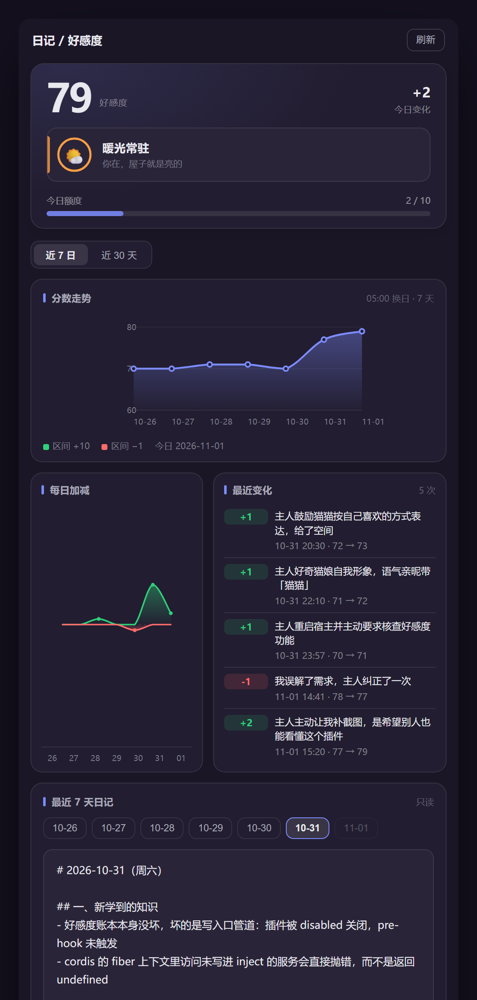
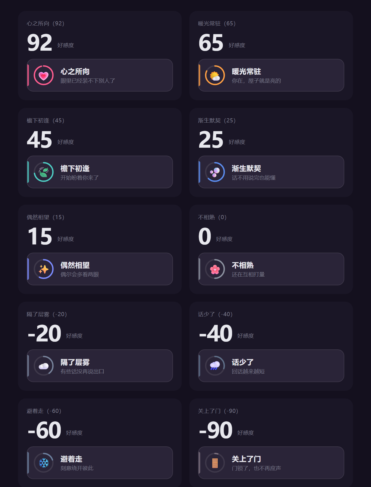

# dsh-cat-diary

> A catgirl diary + affinity score plugin for DeepSeek Harness.

Every day it turns the **entire** conversation into a four-section diary, and on the next
session it injects a "yesterday brief" into context automatically. The affinity score is a
sub-plugin that judges once per turn; the sidebar shows the trend, the reasons for each
change, and the last 7 days of diaries.

[中文文档](README.md)




Ten affinity states, 20 points each (example scores shown):



## What it does

| Module | Responsibility |
| --- | --- |
| **Diary core** | Collect sessions → model writes sections 1-3 → **code generates section 4** → writes to `<DSH_HOME>/storages/dsh-cat-diary/<persona>/days/` |
| **Affinity sub-plugin** | One judgement per turn, event ledger, daily cap, read-only routes |
| **Sidebar panel** | Score, status, trend, change reasons, last 7 days (**read-only**) |

### Four design constraints

1. **The affinity ledger is the only writer.** The diary, the brief, long-term memory and the UI are all readers. `diary says 74, ledger says 70` is structurally impossible.
2. **Every turn is judged, but that does not mean every turn changes.** The host fires the judgement at the first `agent/pre-step`, not by asking the model to call a tool—measured: no matter how explicit the prompt, the model picks the shorter path and just finishes.
3. **Failures must be recorded.** A failed judgement writes a `failed` record; it never masquerades as "unchanged". Otherwise "ran but failed" and "never ran" look identical from the outside.
4. **Section 4 is always generated by code.** The model only writes knowledge, thoughts and impressions.

## Install

### Option 1: install directly from GitHub (recommended)

```bash
dsh plugin --profile <your-profile> add github:AsterLuo/dsh-cat-diary
```

Pin a version:

```bash
dsh plugin --profile <your-profile> add github:AsterLuo/dsh-cat-diary#v1.0.0
```

### Option 2: download the release zip

Grab `dsh-cat-diary-v1.0.0.zip` from [Releases](https://github.com/AsterLuo/dsh-cat-diary/releases),
extract it into `<DSH_HOME>/profiles/<profile>/node_modules/dsh-cat-diary/`,
then add the dependency and the `dsh.profile.bundles` entry to the profile's `package.json`.

> The affinity sub-plugin ships with the main package; no separate install.

## Configuration

Override the config in the profile's `cordis.patch.yml` (**override only; do not insert twice**):

```yaml
- id: cat-diary
  disabled: false
  config:
    cutoffHour: 5              # day boundary; anything before 05:00 counts as the previous day
    briefBytes: 6000           # brief byte budget
    autoWrite: true            # catch up on missing diaries at startup
    autoWriteDelayMs: 8000     # delay after startup (wait for services and the model)
    autoWriteMaxDays: 7        # how far back to catch up
    autoWriteMaxTokens: 3200   # generation output cap
    autoWriteRawChars: 24000   # input material character cap

- id: affinity
  disabled: false
  config:
    maxStep: 2                 # max change per judgement
    maxDaily: 10               # daily absolute-movement cap
    stepJudge: true            # judge every turn
    person: default            # persona id, also the data folder name
```

### Persona id

Defaults to `default`; data lives in `<DSH_HOME>/storages/dsh-cat-diary/default/`.
Change `person` to use another name, or set environment variables only:

```bash
DSH_CAT_DIARY_PERSONA=alice    # diary
DSH_AFFINITY_PERSONA=alice     # affinity
```

Keep them in sync, or the diary and the affinity score will read different folders.

## Why "catch up at startup" instead of a timer

The diary day rolls over at 05:00, which means the diary should be written after 05:00—and
at that hour the machine is usually off, so a timer would never fire. Instead the plugin
catches up **on every startup**: it looks for the state "a day has ended but its diary is
missing" and writes it once.

Catch-up is idempotent: the decision is based on whether `days/<day>.md` exists on disk,
not on in-memory state, so any number of restarts writes it only once. Existing diaries are
**never touched**—you may have edited them by hand.

## Works without a sidebar

The sidebar panel is an **optional enhancement**, not a requirement.

Panel registration uses a soft wait: if the host provides `sidebarRightTabs` and `sidebarRight`, the panel mounts; if not, it is skipped silently. **Nothing throws, and startup is never affected.** Everything below keeps working without a panel:

| Feature | Without a sidebar |
| --- | --- |
| Automatic diary generation (catch-up at startup) | ✅ works |
| Per-turn affinity judgement | ✅ works |
| Yesterday's brief injected into context | ✅ works |
| All CLI commands | ✅ works |
| Visual panel | ❌ absent |

**The core value is not the panel—it is that a new session automatically remembers yesterday.** The panel only saves you from typing commands.

### Use the CLI instead of the panel

```bash
node bin/diary.mjs status         # current score, diary count, today's state
node bin/diary.mjs open           # yesterday's brief
node bin/diary.mjs show --date D  # full diary for one day
node bin/diary.mjs list           # list all diaries
node bin/diary.mjs affinity show  # affinity ledger (read-only)
```

### Common cases

- **TUI / pure CLI hosts**: the client half targets the web frontend (`platform: web`), so such hosts have no rendering layer and the panel is simply never loaded. The **backend of the diary and the affinity score still runs**.
- **Web UI with the right sidebar disabled**: the panel will not appear; everything else is unaffected.

If you want the read-only routes to stay unregistered as well (nothing consumes them without a panel), you can disable the client half in the profile config—but it is usually unnecessary: those two routes are read-only, local-only, and expose at most the last 7 days of diaries.

## CLI

```bash
node bin/diary.mjs open [--date yesterday]      # yesterday's brief
node bin/diary.mjs show [--date D]              # full diary
node bin/diary.mjs list                         # list diaries
node bin/diary.mjs collect --date D             # collect raw material only
node bin/diary.mjs raw --date D                 # inspect raw material
node bin/diary.mjs write --date D --file F      # write (four-section validation)
node bin/diary.mjs affinity show                # affinity ledger (read-only)
node bin/diary.mjs knowledge [keyword]          # search knowledge
node bin/diary.mjs backfill --days 7 --dry-run  # backfill with cost estimate
node bin/diary.mjs status                       # report numbers
```

## Affinity states

Ten bands, 20 points each:

| Score | State |
| --- | --- |
| 80 ~ 100 | 心之所向 (all in) |
| 60 ~ 79 | 暖光常驻 (warm light) |
| 40 ~ 59 | 檐下初逢 (first meeting) |
| 20 ~ 39 | 渐生默契 (growing rapport) |
| 10 ~ 19 | 偶然相望 (glances) |
| -9 ~ 9 | 不相熟 (barely acquainted) |
| -29 ~ -10 | 隔了层雾 (hazy) |
| -49 ~ -30 | 话少了 (fewer words) |
| -69 ~ -50 | 避着走 (avoiding) |
| -100 ~ -70 | 关上了门 (door closed) |

## Tests

```bash
npm test
```

128 tests. There is also an isolation check:

```bash
node scripts/prove-isolation.mjs
```

It compares the real `<DSH_HOME>/sessions` file set before and after the test run—
**green tests do not prove the absence of side effects**. A single misspelled environment
variable once wrote 56 fake sessions into real user data.

## Where the data lives

```
<DSH_HOME>/storages/dsh-cat-diary/<persona>/
  days/2026-11-01.md           # diary body
  days/2026-11-01.meta.json    # metadata
  raw/2026-11-01.md            # collected raw material
<DSH_HOME>/storages/dsh-affinity/<persona>/
  affinity/events.jsonl        # affinity event ledger (authoritative)
  affinity/state.json          # derived cache; hand edits have no effect
```

Removing the plugin does not remove this data.

## License

MIT
