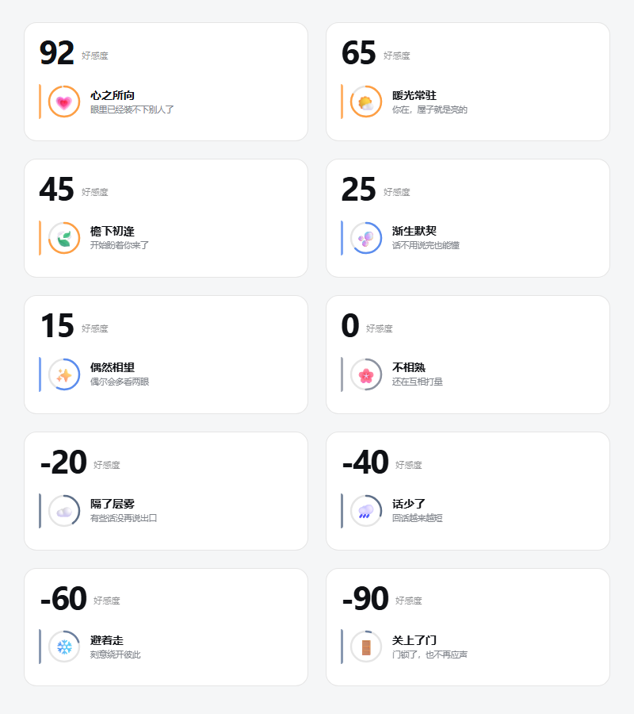
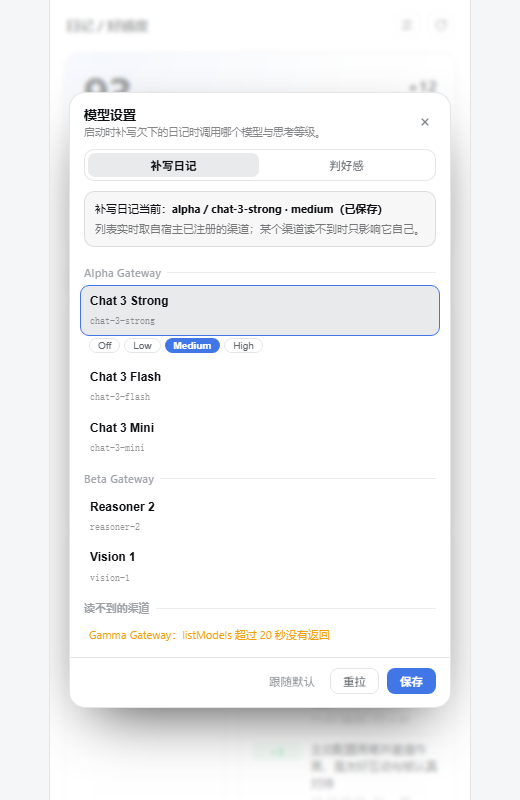
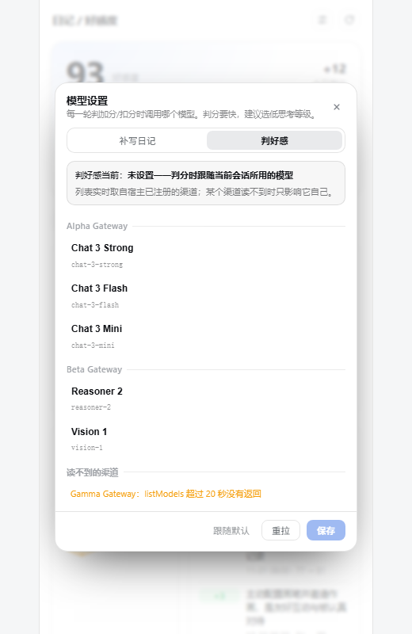

# dsh-cat-diary

> 猫娘日记 + 好感度，为 DeepSeek Harness 做的插件。

[English](README.en.md)

每天把当天**全部**对话写成一篇四栏日记，第二天新开对话时自动注入「昨日速读卡」；
好感度作为子插件每轮自动判定，侧边栏可看走势、加减原因和最近 7 天日记。


十档状态，每 20 分一档（图中为示例分数）：



顶栏右侧两个图标按钮：左边是**模型设置**，右边是**刷新**（截图中的分数、日记、渠道名均为示例数据）。

| 补写日记 | 判好感 |
| --- | --- |
|  |  |

## 它做什么

| 模块 | 职责 |
| --- | --- |
| **日记主体** | 采集会话 → 模型写前三节 → **代码生成第四节** → 写入 `<DSH_HOME>/storages/dsh-cat-diary/<人格>/days/` |
| **好感度子插件** | 每轮判定一次、事件账本、日额度、只读路由 |
| **侧边栏面板** | 分数、状态、走势、加减原因、最近 7 天日记（**只读**）；外加一个模型选择器 |

### 五个设计约束

1. **好感度账本是唯一写入方**。日记、速读卡、长期记忆、UI 全是读者，「日记说 74、账本说 70」这种分歧在结构上不可能发生。
2. **每轮必判，但不代表每轮必变**。判定由宿主在 `agent/pre-step` 首步发起，不是靠提示词求模型调工具——实测提示词写得再清楚，模型也会挑更短的路直接 finish。
3. **失败必须落盘**。判定失败写 `failed` 记录，绝不伪装成「不变」；否则「跑了但失败」和「根本没跑」在外部看起来一模一样。
4. **日记第四节永远是代码产物**。模型只写知识、感想、印象三节。
5. **同一个事实只有一个来源**。人格 id 只解析一次（`resolvePaths().person`）；模型选择只存一处
   （`autoWriteRoute.json`），日记与判分各自读同一份。这条是被两次真故障逼出来的。

## 模型选择器（面板顶栏的设置按钮）

### 为什么需要它

日记补写与好感度判分都要调模型，而**这两件事对模型的要求不一样**：

| 用途 | 要求 |
| --- | --- |
| 补写日记 | 能写长文、理解中文对话，思考等级高一点值得 |
| 好感度判分 | 快、稳、便宜。判分有 12 秒超时，想太久会让整轮判定作废 |

在这之前，两边都硬跟「宿主默认模型」。实测踩过两次同一个坑：

```
{"day":"2026-11-01","error":"生成未正常结束：error（{\"kind\":\"error\",
 \"failure\":{\"message\":\"no adapter registered for provider \\\"buddy\\\"\",
 \"code\":\"NO_ADAPTER\"}}）"}
```

默认模型指向的渠道在后台还没注册好，补写和判分就一起停摆——而外部表现只是「今天没有日记」，
看不出真正原因。现在两边都可以单独钉一个模型。

### 怎么用

点顶栏左边的滑块图标 → 弹窗里两个页签 → 选模型 → 保存。保存后会立刻生效：

- **补写日记**：下一次启动补写就用它
- **判好感**：下一轮判定就用它（优先级高于当前会话所用的模型）

弹窗里的模型与推理等级**全部实时取自宿主已注册的渠道**，没有一个名字是写死的。

### 三个设计细节

**1. 每个渠道单独限时，一个坏渠道不会拖垮整窗**

各 provider 的枚举各自 20 秒超时，元数据解析 6 路并发；某个渠道读不到时只把它标红并写明原因
（见截图最下方的「读不到的渠道」），其余照常可选。整份目录另有 5 分钟缓存。

**2. 保存前由 Host 复核**

前端只做便利性禁用，真正的核对在服务端：provider / model / reasoningEffort 三级都要在**当下**的目录里
存在才允许落盘。防止「目录过期了，存进一个已经不存在的模型」。

**3. 选择存在 storages 里，活过插件升级**

```
<DSH_HOME>/storages/dsh-cat-diary/<人格>/autoWriteRoute.json
{
  "diary": { "provider": "...", "model": "...", "reasoningEffort": "..." },
  "judge": { "provider": "...", "model": "..." }
}
```

不是写进 `cordis.patch.yml` 的原因很实际：插件升级会整包覆盖配置，但不会碰 `storages/`。
旧的扁平格式（只有日记那一条）会被自动当成 `diary` 读，**升级不会丢已有选择**。

优先级固定为：**面板保存值 > 配置里的 autoWriteRoute > 宿主默认模型**。

### 判分侧的跨包约定

判分读的是 cat-diary 目录里的同一个文件（`plugins/dsh-affinity/lib/judge-route.js`，**只读**）。
所以「好感度账本是唯一写入方」这条约束没有被动摇——它只读一个模型偏好，不写任何分数。

> ⚠️ 这是跨包约定：改存储格式时两边要一起改。格式的真源是 `lib/model-choice.js`。

## 安装

### 方式一：从 GitHub 直接装（推荐）

```bash
dsh plugin --profile <你的profile> add github:AsterLuo/dsh-cat-diary
```

指定版本：

```bash
dsh plugin --profile <你的profile> add github:AsterLuo/dsh-cat-diary#v1.1.0
```

### 方式二：下载 release 里的 zip

在 [Releases](https://github.com/AsterLuo/dsh-cat-diary/releases) 下载 `dsh-cat-diary-v1.1.0.zip`，
解压到 `<DSH_HOME>/profiles/<profile>/node_modules/dsh-cat-diary/`，
然后在 profile 的 `package.json` 里加上依赖并写入 `dsh.profile.bundles`。

> 好感度子插件随主包一起装，不需要单独安装。

## 配置

在 profile 的 `cordis.patch.yml` 里覆盖配置（**只覆盖，不要重复 insert**）：

```yaml
- id: cat-diary
  disabled: false
  config:
    person: default            # 人格 id，日记与好感度都用它（务必与下面 affinity 一致）
    cutoffHour: 5              # 换日小时，凌晨 5 点前的对话算前一天
    briefBytes: 6000           # 速读卡字节上限
    autoWrite: true            # 每次启动补写欠下的日记
    autoWriteDelayMs: 8000     # 启动后延迟多久再跑（等服务和模型就绪）
    autoWriteMaxDays: 7        # 最多往回追几天
    autoWriteMaxTokens: 3200   # 生成输出上限
    autoWriteRawChars: 24000   # 喂给模型的原料字符上限
    # autoWriteRoute:          # 可选：补写用的模型兜底（面板上选过就以面板为准）
    #   provider: <provider>
    #   model: <model>

- id: affinity
  disabled: false
  config:
    maxStep: 4                 # 单次最大变化量
    maxDaily: 16               # 每日绝对值累计上限
    stepJudge: true            # 每轮自动判定
    person: default            # 人格 id，数据目录名
```

### 人格 id

默认是 `default`，数据落在 `<DSH_HOME>/storages/dsh-cat-diary/default/`。
想用别的名字就改 `person`；也可以只设环境变量：

```bash
DSH_CAT_DIARY_PERSONA=alice    # 日记
DSH_AFFINITY_PERSONA=alice     # 好感度
```

两者要一致，否则日记和好感度会读写不同的目录。

> **这一条曾经真的踩过**：日记用环境变量兜底解析出 `alice`，而读好感度那一行写的是
> `config.person ?? 'default'`，于是日记写进 `alice/`、账本却去 `default/` 找，
> 第四节永远显示「账本为空」。
> 现在 `resolvePaths()` 会把解析后的 `person` 一起返回，**同一个"我是谁"只有一个来源**。

## 为什么是「开机补写」而不是定时任务

日记日按 05:00 换日，意味着日记该在 05:00 之后生成——而那个点电脑通常是关着的，定时器根本不会响。
所以改成**每次启动时补作业**：抓住「一天已经结束、但日记还没写」这个状态，写一次就够。

补写是幂等的：判断依据是磁盘上有没有 `days/<day>.md`，不是内存状态，所以重启多少次都只写一次。
已存在的日记**一律不碰**——你可能手动改过。

## 没有侧边栏也能用

侧边栏面板是**可选增强**，不是必需品。

插件在注册面板时用的是软等待：宿主有 `sidebarRightTabs` 和 `sidebarRight` 就挂上，没有就安静跳过，**不会报错、不会影响启动**。所以下面这些功能在无面板环境下全部照常工作：

| 功能 | 无侧边栏时 |
| --- | --- |
| 日记自动生成（开机补写） | ✅ 正常 |
| 好感度每轮自动判定 | ✅ 正常 |
| 昨日速读卡注入上下文 | ✅ 正常 |
| 全部 CLI 命令 | ✅ 正常 |
| 模型选择器 | ❌ 没有（改配置里的 `autoWriteRoute` 等效） |
| 可视化面板 | ❌ 没有 |

**核心价值不在面板，在于「新会话能自动记得昨天」。** 面板只是让你不用敲命令就能看到数据。

### 用 CLI 代替面板

```bash
node bin/diary.mjs status         # 当前分数、日记数、今日状态
node bin/diary.mjs open           # 昨日速读卡
node bin/diary.mjs show --date D  # 某天的完整日记
node bin/diary.mjs list           # 列出所有日记
node bin/diary.mjs affinity show  # 好感度账本（只读）
```

### 常见情形

- **TUI / 纯命令行宿主**：客户端插件基于 Web 前端（`platform: web`），这类宿主根本没有渲染层，面板不会被加载。日记与好感度的**后端部分照常运行**。
- **有 Web UI 但右侧栏被关掉**：面板不会出现，其余功能不受影响。

想让只读路由也不注册（面板用不到时），可以在 profile 配置里把客户端那半关掉——但一般没有必要，那两条路由只读、只在本机、只放最近 7 天日记。

## 命令行

```bash
node bin/diary.mjs open [--date yesterday]      # 昨日速读卡
node bin/diary.mjs show [--date D]              # 整篇日记
node bin/diary.mjs list                         # 列出日记
node bin/diary.mjs collect --date D             # 只采集原料
node bin/diary.mjs raw --date D                 # 看原料
node bin/diary.mjs write --date D --file F      # 写入（四栏校验）
node bin/diary.mjs affinity show                # 好感度账本（只读）
node bin/diary.mjs knowledge [关键词]           # 检索知识
node bin/diary.mjs backfill --days 7 --dry-run  # 补历史 + 成本预估
node bin/diary.mjs status                       # 报数
```

## 好感度状态

每 20 分一档，共 10 档：

| 分数 | 状态 |
| --- | --- |
| 80 ~ 100 | 心之所向 |
| 60 ~ 79 | 暖光常驻 |
| 40 ~ 59 | 檐下初逢 |
| 20 ~ 39 | 渐生默契 |
| 10 ~ 19 | 偶然相望 |
| -9 ~ 9 | 不相熟 |
| -29 ~ -10 | 隔了层雾 |
| -49 ~ -30 | 话少了 |
| -69 ~ -50 | 避着走 |
| -100 ~ -70 | 关上了门 |

## 测试

```bash
npm test
```

143 项测试（含起真 HTTP server 打路由、用假 `llm` 跑完整判分链路）。另外有个隔离验证脚本：

```bash
node scripts/prove-isolation.mjs
```

它会比对真实 `<DSH_HOME>/sessions` 在测试前后的文件集合变化 ——
**测试绿不等于没有副作用**，一次环境变量拼错曾让 56 条假会话写进真实用户数据。

## 数据在哪

```
<DSH_HOME>/storages/dsh-cat-diary/<人格>/
  days/2026-11-01.md           # 日记正文
  days/2026-11-01.meta.json    # 元信息
  raw/2026-11-01.md            # 采集的原料
  autoWriteRoute.json          # 面板上选的模型（diary / judge 两条）
<DSH_HOME>/storages/dsh-affinity/<人格>/
  affinity/events.jsonl        # 好感度事件账本（权威）
  affinity/state.json          # 派生缓存，手改无效
```

删插件不影响这些数据。

## License

MIT
